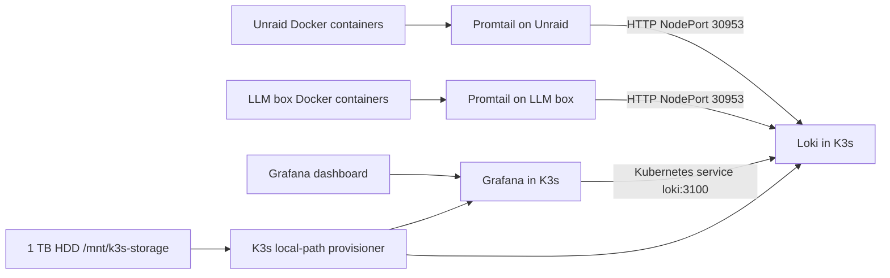

# Homelab Logging Infrastructure Provisioning

**Date:** 2026-08-06
**Purpose:** Recreate the Loki, Grafana, Promtail, and K3s storage infrastructure used to collect and inspect LiteLLM, llama.cpp, and OpenClaw logs.

This is an operational runbook. The repository does not currently contain the Helm values, Kubernetes manifests, or host Docker Compose files used by the live installation. Keep the values and host config files in a private deployment location; do not commit passwords, API tokens, SSH keys, or generated Grafana session data.

## Architecture



## Verified Topology

| Component | Host | Image or service | Port or path |
|---|---|---|---|
| K3s | `192.168.1.206` | K3s v1.33.6+k3s1 | Kubernetes API |
| Loki | K3s namespace `o11y` | Loki v3.6.11, Helm chart 7.2.0 | Internal `loki:3100`, NodePort `30953` |
| Grafana | K3s namespace `o11y` | Grafana v12.3.1 | NodePort `30300` |
| Promtail | Unraid `192.168.1.194` | `grafana/promtail:3.6.8` | Docker container `GrafanaPromtail` |
| Promtail | LLM box `192.168.1.149` | `grafana/promtail:3.6.8` | Docker container `promtail` |
| K3s storage | K3s node | ext4 HDD | `/mnt/k3s-storage` |
| Loki datasource | Grafana | Loki proxy datasource | UID `P8E80F9AEF21F6940` |

The NodePort is intentional. Promtail runs outside the cluster, so it must reach Loki through the K3s node address rather than the internal Kubernetes service name.

## Prerequisites

From Windows, use the existing kubeconfig. No SSH hop to the K3s node is required for normal `kubectl` or Helm operations.

```powershell
kubectl config current-context
kubectl cluster-info
kubectl get nodes -o wide
helm version
```

You also need:

- `kubectl` configured for the K3s cluster
- Helm 3
- Docker access to Unraid and the LLM box
- Root access to the K3s node only for disk partitioning and mounting
- A Grafana admin password supplied at deployment time, never written into this document

## Phase 1: Prepare The K3s Storage Disk

The live installation used `/dev/sdb`, formatted as ext4, with UUID `3eafc331-0c8c-4149-a3a7-d14c45fe7784` and mount point `/mnt/k3s-storage`.

These commands are destructive. Verify the disk model, size, and device name before running `mklabel` or `mkfs`.

Run on the K3s node console or through an approved administrative SSH session:

```bash
lsblk -o NAME,SIZE,MODEL,FSTYPE,MOUNTPOINTS

# Verify that /dev/sdb is the intended 1 TB disk before continuing.
sudo parted /dev/sdb --script mklabel gpt
sudo parted /dev/sdb --script mkpart primary ext4 0% 100%
sudo mkfs.ext4 -L k3s-storage /dev/sdb1

sudo mkdir -p /mnt/k3s-storage
UUID=$(sudo blkid -s UUID -o value /dev/sdb1)
echo "UUID=$UUID /mnt/k3s-storage ext4 defaults,nofail 0 2" | sudo tee -a /etc/fstab
sudo mount -a
sudo chown root:root /mnt/k3s-storage
sudo chmod 755 /mnt/k3s-storage

df -h /mnt/k3s-storage
findmnt /mnt/k3s-storage
```

Do not use `/dev/sdb` directly in `/etc/fstab`; use the filesystem UUID so device naming changes do not mount the wrong disk.

## Phase 2: Point K3s local-path Storage At The HDD

Inspect the existing provisioner configuration before changing it:

```powershell
kubectl -n kube-system get configmap local-path-config -o yaml
kubectl get storageclass local-path -o yaml
```

Edit the ConfigMap and replace the node path in its `config.json` or `config` data with `/mnt/k3s-storage`. Preserve the existing JSON shape and the `DEFAULT_PATH_FOR_NON_LISTED_NODES` entry. The resulting node path mapping should contain:

```json
{
  "nodePathMap": [
    {
      "node": "DEFAULT_PATH_FOR_NON_LISTED_NODES",
      "paths": ["/mnt/k3s-storage"]
    }
  ]
}
```

Apply the edit:

```powershell
kubectl -n kube-system edit configmap local-path-config
kubectl -n kube-system get configmap local-path-config -o yaml
kubectl get storageclass local-path
```

Existing PVCs do not automatically move when the provisioner path changes. Apply the new path before creating the Loki and Grafana PVCs. If a provisioner restart is needed, identify the workload first and restart only that workload:

```powershell
kubectl -n kube-system get deployment,daemonset | Select-String local-path
kubectl -n kube-system rollout restart deployment/local-path-provisioner
kubectl -n kube-system rollout status deployment/local-path-provisioner
```

If the provisioner is a different workload kind in a future K3s release, use the resource shown by the first command instead of assuming `deployment`.

## Phase 3: Install Loki In K3s

Create the namespace and Helm repository:

```powershell
kubectl create namespace o11y
helm repo add grafana https://grafana.github.io/helm-charts
helm repo update
helm show values grafana/loki --version 7.2.0 > loki-chart-values-reference.yaml
```

Create a private `loki-values.yaml`. The following profile matches the live installation: single binary, one replica, filesystem storage, seven-day retention, and a 50 GiB PVC on `local-path`.

```yaml
deploymentMode: SingleBinary

loki:
  auth_enabled: false
  commonConfig:
    replication_factor: 1
  storage:
    type: filesystem
  schemaConfig:
    configs:
      - from: "2024-04-01"
        store: tsdb
        object_store: filesystem
        schema: v13
        index:
          prefix: index_
          period: 24h
  limits_config:
    retention_period: 168h
    allow_structured_metadata: true
    volume_enabled: true
  compactor:
    retention_enabled: true
    delete_request_store: filesystem

singleBinary:
  replicas: 1
  persistence:
    enabled: true
    size: 50Gi
    storageClass: local-path

gateway:
  enabled: false
```

Install or upgrade Loki:

```powershell
helm upgrade --install loki grafana/loki `
  --namespace o11y `
  --version 7.2.0 `
  --values .\loki-values.yaml

kubectl -n o11y rollout status statefulset/loki-single
kubectl -n o11y get pods,pvc,svc -l app.kubernetes.io/name=loki
```

Expose the Loki service as NodePort `30953` for Promtail. First identify the service name and port; chart defaults can change between versions:

```powershell
kubectl -n o11y get svc -l app.kubernetes.io/name=loki -o wide
kubectl -n o11y edit service loki
```

Set the selected Loki HTTP service to:

```yaml
spec:
  type: NodePort
  ports:
    - name: http
      port: 3100
      targetPort: http
      nodePort: 30953
```

If chart 7.2.0 creates a gateway service instead of a direct `loki` service, expose the gateway service on `30953` and use its HTTP port. Verify from Windows:

```powershell
Invoke-WebRequest http://192.168.1.206:30953/ready
kubectl -n o11y get svc
kubectl -n o11y get pvc
```

A healthy Loki readiness response is required before starting Promtail.

## Phase 4: Install Grafana In K3s

Create a private `grafana-values.yaml`. Supply the admin password through a local secret mechanism or Helm command line; do not commit it.

```yaml
persistence:
  enabled: true
  size: 10Gi
  storageClassName: local-path

service:
  type: NodePort
  nodePort: 30300

adminUser: admin

# Provision the Loki datasource with a stable UID.
datasources:
  datasources.yaml:
    apiVersion: 1
    datasources:
      - name: Loki
        uid: P8E80F9AEF21F6940
        type: loki
        access: proxy
        url: http://loki:3100
        isDefault: true
        jsonData: {}
```

Install or upgrade Grafana. Replace the placeholder with the password through a secret manager or an environment variable in your private shell session:

```powershell
$env:GRAFANA_ADMIN_PASSWORD = '<set-locally>'
helm upgrade --install grafana grafana/grafana `
  --namespace o11y `
  --values .\grafana-values.yaml `
  --set-string adminPassword=$env:GRAFANA_ADMIN_PASSWORD

kubectl -n o11y rollout status deployment/grafana
kubectl -n o11y get pods,pvc,svc -l app.kubernetes.io/name=grafana
Invoke-RestMethod http://192.168.1.206:30300/api/health
```

The Grafana datasource URL is internal to K3s (`http://loki:3100`). Promtail must use the external NodePort (`http://192.168.1.206:30953/loki/api/v1/push`).

## Phase 5: Configure Promtail On Unraid

Create `/mnt/user/appdata/promtail/config.yml` on Unraid:

```yaml
server:
  http_listen_port: 9080
  grpc_listen_port: 0

positions:
  filename: /tmp/positions.yaml

clients:
  - url: http://192.168.1.206:30953/loki/api/v1/push

scrape_configs:
  - job_name: docker
    docker_sd_configs:
      - host: unix:///var/run/docker.sock
        refresh_interval: 5s
    relabel_configs:
      - source_labels: [__meta_docker_container_name]
        regex: '/(.*)'
        target_label: container
      - source_labels: [__meta_docker_container_log_stream]
        target_label: stream
      - target_label: host
        replacement: unraid
      - source_labels: [__meta_docker_container_log_path]
        target_label: __path__
    pipeline_stages:
      - docker: {}
      - replace:
          expression: '\\x1b\\[[0-9;]*[a-zA-Z]'
          replace: ''
```

Create the positions directory and run the container:

```bash
mkdir -p /mnt/user/appdata/promtail/positions

docker rm -f GrafanaPromtail 2>/dev/null || true
docker run -d \
  --name GrafanaPromtail \
  --restart unless-stopped \
  -v /var/run/docker.sock:/var/run/docker.sock:ro \
  -v /var/lib/docker/containers:/var/lib/docker/containers:ro \
  -v /mnt/user/appdata/promtail/config.yml:/etc/promtail/config.yml:ro \
  -v /mnt/user/appdata/promtail/positions:/tmp \
  grafana/promtail:3.6.8 \
  -config.file=/etc/promtail/config.yml

docker ps --filter name=GrafanaPromtail
docker logs GrafanaPromtail --tail 50
```

The labels produced by this configuration include `container`, `host=unraid`, and `stream`. The replace stage removes ANSI color sequences from LiteLLM logs before ingestion.

## Phase 6: Configure Promtail On The LLM Box

Create `/opt/promtail/config.yml` on `192.168.1.149` with the same configuration, changing only the host label:

```yaml
server:
  http_listen_port: 9080
  grpc_listen_port: 0

positions:
  filename: /tmp/positions.yaml

clients:
  - url: http://192.168.1.206:30953/loki/api/v1/push

scrape_configs:
  - job_name: docker
    docker_sd_configs:
      - host: unix:///var/run/docker.sock
        refresh_interval: 5s
    relabel_configs:
      - source_labels: [__meta_docker_container_name]
        regex: '/(.*)'
        target_label: container
      - source_labels: [__meta_docker_container_log_stream]
        target_label: stream
      - target_label: host
        replacement: llm-box
      - source_labels: [__meta_docker_container_log_path]
        target_label: __path__
    pipeline_stages:
      - docker: {}
      - replace:
          expression: '\\x1b\\[[0-9;]*[a-zA-Z]'
          replace: ''
```

Run Promtail on the LLM box:

```bash
sudo mkdir -p /opt/promtail/positions
sudo docker rm -f promtail 2>/dev/null || true
sudo docker run -d \
  --name promtail \
  --restart unless-stopped \
  -v /var/run/docker.sock:/var/run/docker.sock:ro \
  -v /var/lib/docker/containers:/var/lib/docker/containers:ro \
  -v /opt/promtail/config.yml:/etc/promtail/config.yml:ro \
  -v /opt/promtail/positions:/tmp \
  grafana/promtail:3.6.8 \
  -config.file=/etc/promtail/config.yml

sudo docker ps --filter name=promtail
sudo docker logs promtail --tail 50
```

Expected discovered containers include `llama-cpp-server`, `portainer`, and `promtail`. The labels include `host=llm-box`.

## Phase 7: Verify The Complete Pipeline

### Kubernetes health

```powershell
kubectl -n o11y get pods -o wide
kubectl -n o11y get pvc
kubectl -n o11y get svc
kubectl -n o11y describe pvc loki-single-0
kubectl -n o11y describe pvc grafana
```

Expected state:

- Loki pod is `Running` and `Ready`.
- Grafana pod is `Running` and `Ready`.
- Loki PVC is approximately `50Gi` on `local-path`.
- Grafana PVC is approximately `10Gi` on `local-path`.
- Loki HTTP service exposes NodePort `30953`.
- Grafana service exposes NodePort `30300`.

### Host-side health

```bash
# Run on Unraid
 docker ps --filter name=GrafanaPromtail
 docker logs GrafanaPromtail --tail 100

# Run on the LLM box
 docker ps --filter name=promtail
 docker logs promtail --tail 100
```

Look for successful pushes and absence of configuration or connection errors.

### Grafana browser validation

Open:

```text
http://192.168.1.206:30300/d/err-mon/error-monitoring?orgId=1&from=now-6h&to=now
```

Use Grafana Explore in the browser and verify a Loki query returns logs. Do not treat a direct request to the Loki NodePort as sufficient validation. The browser-side Grafana datasource proxy must work:

```javascript
const response = await fetch('/api/ds/query', {
  method: 'POST',
  headers: { 'Content-Type': 'application/json' },
  body: JSON.stringify({
    queries: [{
      refId: 'A',
      datasource: { type: 'loki', uid: 'P8E80F9AEF21F6940' },
      expr: 'sum by (msg) (count_over_time({container="LiteLLM"} |= "ERROR" | pattern "<_> - <_> <_>: <_> - <msg>" [6h]))',
      queryType: 'instant',
      instant: true,
      direction: 'backward'
    }],
    from: 'now-6h',
    to: 'now'
  })
});
const data = await response.json();
```

The three dashboard tiles must be:

1. **LiteLLM Errors** - LiteLLM-specific pattern and `container="LiteLLM"`.
2. **Llama.cpp Errors** - llama.cpp-specific pattern with task IDs excluded from `msg`.
3. **OpenClaw Errors** - OpenClaw-specific pattern with `conn=` and `id=` excluded from `msg`.

Each tile must show one row per normalized message with an `Occurrences` value. A repeated message on multiple time rows means the target was saved as a range query; set both `queryType: instant` and `instant: true`.

## Troubleshooting

### Grafana tile shows duplicate messages

Use:

- `sum by (msg) (count_over_time(...))` in LogQL.
- `queryType: "instant"` and `instant: true` in the target.
- `labelsToFields` followed by `organize` only.

Do not add a second Grafana `groupBy` after Loki has aggregated the series.

### Grafana tile shows no data

Check in this order:

```powershell
kubectl -n o11y get svc loki
kubectl -n o11y get endpoints loki
kubectl -n o11y logs deploy/grafana --tail 100
```

Then verify the browser datasource proxy request at `/api/ds/query`. A direct Loki request succeeding does not prove Grafana can render the panel.

### Promtail is running but Loki has no logs

Check:

```bash
docker inspect GrafanaPromtail
# or
sudo docker inspect promtail
```

Verify all of these mounts exist:

- `/var/run/docker.sock` read-only
- `/var/lib/docker/containers` read-only
- The host Promtail config file
- The host positions directory mounted at `/tmp`

Verify the client URL is exactly:

```text
http://192.168.1.206:30953/loki/api/v1/push
```

### Loki or Grafana PVC is pending

```powershell
kubectl get storageclass local-path
kubectl -n o11y describe pvc <pvc-name>
kubectl -n kube-system get configmap local-path-config -o yaml
```

Confirm `/mnt/k3s-storage` is mounted on the K3s node before recreating a pending workload.

### Grafana logs show a 404 for public dashboards

`/api/dashboards/uid/<uid>/public-dashboards` may return 404 when public dashboards are not enabled. This is unrelated to Loki ingestion. Inspect the actual datasource query and visible tile state instead.

## Backup Checklist

Back up these items outside the cluster:

- `loki-values.yaml`
- `grafana-values.yaml` without the password, plus the password in a secret manager
- `/mnt/user/appdata/promtail/config.yml` and positions directory on Unraid
- `/opt/promtail/config.yml` and positions directory on the LLM box
- Grafana dashboard export after final browser validation
- The filesystem UUID and `/etc/fstab` entry for `/mnt/k3s-storage`
- Helm release values:

```powershell
helm get values loki -n o11y -a > loki-live-values.yaml
helm get values grafana -n o11y -a > grafana-live-values.yaml
```

Do not store Grafana passwords, API tokens, SSH private keys, or kubeconfig contents in Git.

## Related Documents

- [grafana-loki-error-dashboard.md](grafana-loki-error-dashboard.md) - exact three-tile dashboard queries and duplicate-row fix
- [loki-error-query skill](../skills/loki-error-query/SKILL.md) - ad hoc LiteLLM, llama.cpp, and OpenClaw queries
- [k3s-kubectl-commands skill](../skills/k3s-kubectl-commands/SKILL.md) - general K3s operations
- [openclaw-ssh-setup instructions](../instructions/openclaw-ssh-setup.instructions.md) - SSH key setup for host administration
